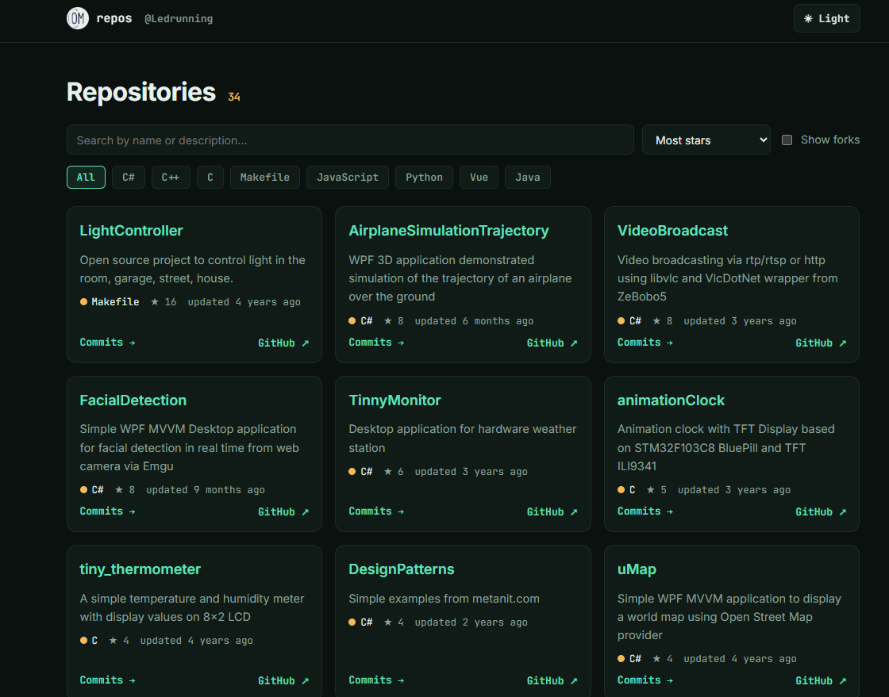

# GitHub Repositories Viewer

Vue 3 + Vite client that lists a GitHub user's public repositories and shows recent commits per branch.

- Search, language filter, sorting, forks toggle
- Commits use the repository's real default branch, with a branch selector
- Loading / error / rate-limit states, 10-minute response cache (GitHub allows 60 unauthenticated requests per hour)
- Hash routing (`#/r/<repo>`), so the back button and direct links work
- Dark and light theme

-   ## UI Layouts
  

## Run

```bash
npm install
npm run dev      # http://localhost:5173
npm run build    # outputs ./dist
```

Change the user in `src/api.js` or create `.env.local` with `VITE_GH_USER=YourName`.

## Deploy to GitHub Pages

The build uses a relative base (`./`), so `dist/` can be published as is (for example with a GitHub Actions Pages workflow or by copying `dist/` into a `gh-pages` branch).
